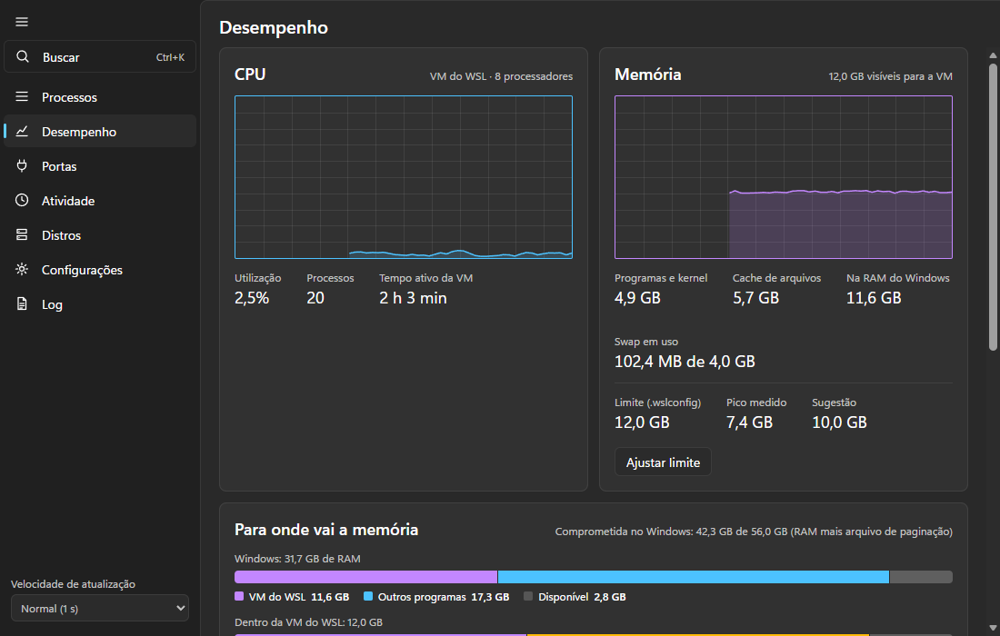
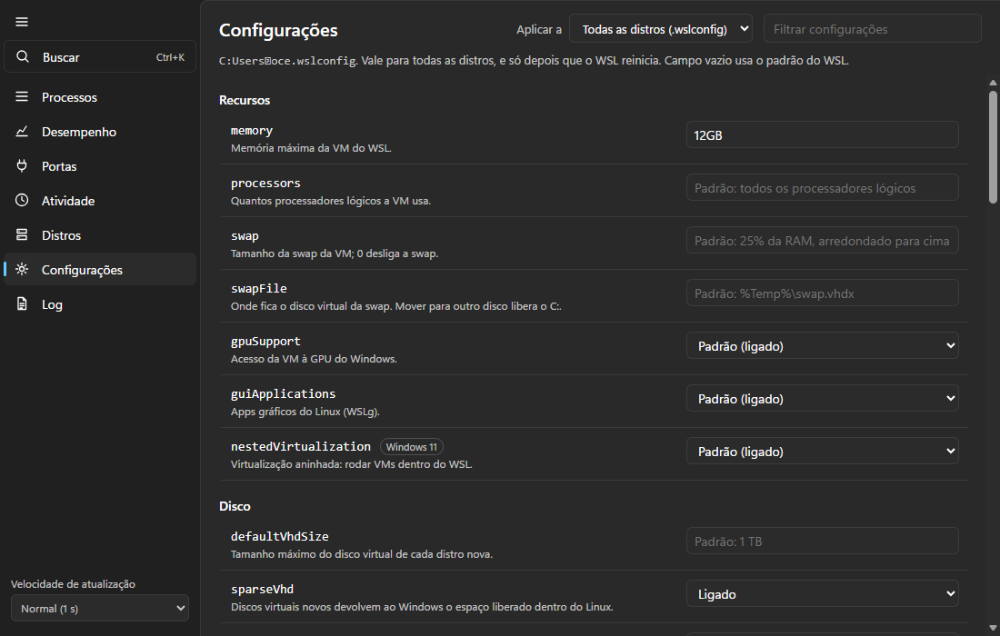

# Toca do Pinguim

Gerenciador de tarefas para o WSL, no formato do Gerenciador de Tarefas do Windows. Ele
observa e gerencia sem mudar o ciclo de vida das distros: nenhuma fica ligada por causa
do app.

> **In English:** a Task Manager-style app for WSL on Windows 10 and 11. It shows processes,
> CPU, memory and listening ports of every distro, lets you start, stop and restart distros,
> edits every documented `.wslconfig` and per-distro `/etc/wsl.conf` setting, and logs WSL
> failures. It never keeps a distro running on its own. Install with
> `irm https://raw.githubusercontent.com/SaLuanVitor/toca-do-pinguim/main/scripts/instalar.ps1 | iex`.
> The interface is in Brazilian Portuguese.


| Desempenho | Configurações |
|---|---|
|  |  |

As capturas são do modo demonstração, com dados simulados.

| Aba | O que tem |
|---|---|
| Processos | processos de cada distro com CPU e memória; encerramento por SIGTERM ou SIGKILL |
| Desempenho | gráficos de CPU e memória da VM; limite de memória com pico medido e sugestão |
| Portas | sockets em escuta na VM, o processo e a distro de cada um |
| Atividade | distros que ligaram e desligaram, quedas do WSL, processos encerrados, falta de memória, configuração |
| Distros | iniciar, terminar, reiniciar e desligar o WSL |
| Configurações | as 42 chaves do `.wslconfig` e as 19 do `/etc/wsl.conf` de cada distro, em grupos, com o padrão de cada uma e validação |
| Log | o log técnico, por padrão só avisos e erros |

Ctrl+K abre uma busca única por processo, porta, distro ou ação.

## Instalar

Cada versão em [Releases](https://github.com/SaLuanVitor/toca-do-pinguim/releases) traz o
instalador (`_x64-setup.exe`), uma versão portátil (`_x64-portable.zip`) e o
`SHA256SUMS.txt` para conferir o download. Requer Windows 10 ou 11 x64 com WSL 2. Ainda
não há assinatura digital, então o SmartScreen avisa na primeira execução: "Mais
informações" e depois "Executar assim mesmo". O que mudou em cada versão está no
[CHANGELOG](CHANGELOG.md).

Instalado pelo instalador, o app avisa quando sai versão nova e se atualiza com um clique.
Ele procura ao abrir e a cada 6 horas, e não baixa nada sem você pedir. O instalador baixado
é conferido contra uma assinatura própria do projeto antes de rodar.

A instalação é só para o seu usuário e não pede administrador. Pelo PowerShell:

| Para | Comando |
|---|---|
| Instalar a versão mais recente (confere o SHA256 antes) | `irm https://raw.githubusercontent.com/SaLuanVitor/toca-do-pinguim/main/scripts/instalar.ps1 \| iex` |
| Abrir | `start toca-do-pinguim`, ou `toca-do-pinguim` no Win+R |
| Remover (mantém histórico e log) | `irm https://raw.githubusercontent.com/SaLuanVitor/toca-do-pinguim/main/scripts/desinstalar.ps1 \| iex` |
| Remover e apagar os dados | `& ([scriptblock]::Create((irm https://raw.githubusercontent.com/SaLuanVitor/toca-do-pinguim/main/scripts/desinstalar.ps1))) -ApagarDados` |
| Instalar ou remover sem perguntas, com o arquivo já baixado | `toca-do-pinguim_X.Y.Z_x64-setup.exe /S` e `"%LOCALAPPDATA%\Toca do Pinguim\uninstall.exe" /S` |

Também dá para remover por Configurações > Aplicativos > Aplicativos instalados. A versão
portátil não instala nada: é abrir o `toca-do-pinguim.exe`. Se o app já estiver aberto, abri-lo
de novo só traz a janela para frente.

## Como funciona

O Windows enxerga todas as distros como um processo só (`vmmemWSL`). Os processos só
podem ser lidos por dentro, então o app copia um agente para cada distro em execução e
conversa com ele por stdin e stdout, uma linha JSON por mensagem.

| Parte | Onde | O que faz |
|---|---|---|
| `crates/protocolo` | as duas pontas | tipos das mensagens; o mesmo crate compila para Windows e Linux |
| `crates/agente` | dentro da distro | binário estático (musl) que lê `/proc` e aplica sinais; recusa o PID 1 |
| `src-tauri` | Windows | lista distros, supervisiona os agentes, guarda histórico e atividade, edita o `.wslconfig` |
| `src` | WebView2 | SvelteKit em modo SPA |

O agente vai para `/var/lib/toca-do-pinguim/agente-<hash>` dentro de cada distro, numa pasta
que só o root lê e grava, copiado pelo stdin do `wsl.exe`. Ele sai quando o stdin fecha, então fechar o app encerra todos os agentes.
Além dos processos, ele lê as portas em escuta a cada 5 amostras e as mortes por falta de
memória no `/dev/kmsg`.

**Ociosidade.** O WSL desliga uma distro quando não sobra sessão aberta nela (cada
`wsl.exe` conectado aparece lá dentro como um `SessionLeader`). Medido no WSL 2.6.1 numa
Debian com systemd: com `cron`, `dbus` e `journald` rodando, ela desligou 16 s depois que
a última sessão fechou. O agente roda numa sessão, então sai sozinho quando a dele é a
única, e o app espera o `instanceIdleTimeout` (padrão 15 s, lido do `.wslconfig`) mais 5 s
antes de subir outro. Se a distro continua ligada depois disso, algo além do app a segura.
Toda chamada ao `wsl.exe` tem prazo, porque uma sessão presa também segura a distro.

Não foi medido se um processo solto da sessão (`setsid`) segura uma distro sem systemd: o
único teste disso coincidiu com o serviço do WSL parando de responder.

Com a janela minimizada, as amostras param de ir ao front e os agentes passam a ler a
cada 5 s.

**Dados.** Em `%APPDATA%\com.luan.tocadopinguim`: `memoria.csv` (pico de memória usada por
minuto, 30 dias) e `atividade.jsonl` (últimos 1000 eventos). Na primeira abertura, os dois
são copiados de `%APPDATA%\com.luan.wsltm`, a pasta de quando o app se chamava Gerenciador
de WSL; a pasta antiga fica como está. A sugestão de limite é o pico
dos últimos 7 dias com 25% de folga, arredondado para cima em GB, e só aparece depois de
uma hora de dados. Gravar o limite troca só a linha `memory` do `.wslconfig` e guarda a
versão anterior em `.wslconfig.toca-do-pinguim.bak`.

## Desenvolvimento

Requisitos: Rust com o alvo `x86_64-unknown-linux-musl` e Node.

```bash
rustup target add x86_64-unknown-linux-musl
npm install
npm run tauri dev
```

O agente é compilado no Windows com o `rust-lld` (ver `.cargo/config.toml`), sem
toolchain dentro da distro. `npm run tauri dev` e `npm run tauri build` compilam o agente
antes do app, porque o binário dele é embutido no executável.

Aberto num navegador comum (`npm run dev`), o front roda em modo demonstração, com
dados simulados e um aviso na tela.

## Branches

| Branch | Recebe | Por |
|---|---|---|
| `main` | só versões prontas; é dela que saem as tags `vX.Y.Z` | PR de `develop` |
| `develop` | o trabalho do dia a dia | PR de `feat/...`, `fix/...`, `release/...` e do Dependabot |

As duas são protegidas: nada entra sem PR, os workflows Verificar e Segurança precisam
passar, e não se apaga nem se reescreve a história delas. As tags `v*` também não podem ser
apagadas nem movidas.

## Publicar uma versão

A versão mora no `package.json`. O `tauri.conf.json` lê de lá, e o
`scripts/sincronizar-versao.mjs` copia o número para o `Cargo.toml` e o `Cargo.lock`.

1. Numa branch `release/X.Y.Z` saída de `develop`, mova o que está em "Não lançado" no
   `CHANGELOG.md` para uma seção da versão e faça o commit.
2. Rode `npm version X.Y.Z --no-git-tag-version` e faça o commit `chore: versão X.Y.Z`. O
   comando sincroniza a versão nos arquivos do Rust.
3. Abra o PR para `develop` e, depois de mesclado, o PR de `develop` para `main`.
4. Na `main` atualizada, crie e envie a tag: `git tag -a vX.Y.Z -m "Toca do Pinguim X.Y.Z"` e
   envie só ela ao remoto.
5. O workflow Publicar confere que a tag está na `main` e bate com a versão, gera os pacotes,
   assina o instalador e abre uma release em rascunho com as notas do CHANGELOG. Revise e
   publique pela página de Releases.

Rodar o Publicar à mão, pela aba Actions, gera os pacotes sem assinatura, como artefato, sem
release.

A atualização automática só enxerga a release depois de publicada, porque lê o
`latest.json` de `releases/latest`. A chave privada que assina o instalador fica no secret
`TAURI_SIGNING_PRIVATE_KEY` do ambiente `publicacao`, que só aceita tags `v*`, e só o job
`assinar` a recebe: ele baixa o instalador já montado e roda o assinador do Tauri numa
versão fixa, sem passar pelo build. A chave pública correspondente está em
`tauri.conf.json`. **Perder a chave privada impede atualizar quem já instalou:** uma chave
nova exige que todos reinstalem à mão.

## Medido em 2026-10-28

Windows 11, WSL 2.6.1, duas distros rodando (Ubuntu com 16 processos, docker-desktop
com 162), executável de release:

| Medida | Valor |
|---|---|
| Executável | 3,8 MB |
| Agente | cerca de 0,5 MB de memória, 1 a 20 ms por leitura conforme o número de processos |
| CPU da árvore do app, janela visível, 1 leitura/s | 3,2% a 3,9% de um núcleo |
| CPU da árvore do app, janela minimizada | 0,2% de um núcleo |
| Memória privada da árvore do app | 226 a 273 MB, quase toda do WebView2 |
| App aberto, Debian ligada sem sessão | agente saiu 2 s depois; o WSL a desligou 16 s depois disso |
| App aberto, Debian com uma sessão de 40 s | agente ficou durante a sessão e saiu quando ela fechou; desligou 16 s depois |

Medições únicas, numa máquina; não são dado de campo.

## Contribuir

Veja o [CONTRIBUTING.md](CONTRIBUTING.md). Falha de segurança se relata em particular, como
descrito no [SECURITY.md](SECURITY.md). O projeto segue um [código de conduta](CODE_OF_CONDUCT.md).

## Licença

[MIT](LICENSE). As licenças das bibliotecas de terceiros incluídas no app vão no
`THIRD-PARTY-NOTICES.md` de cada versão em Releases e dentro do zip portátil.
