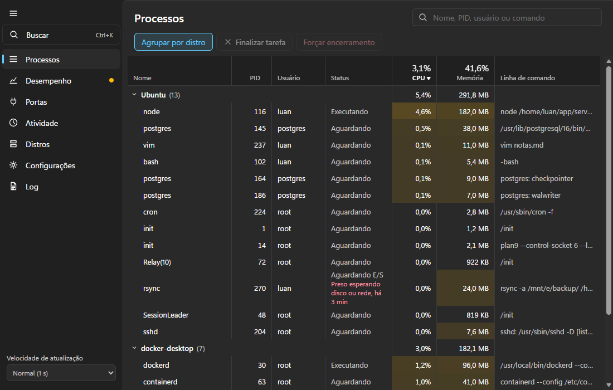
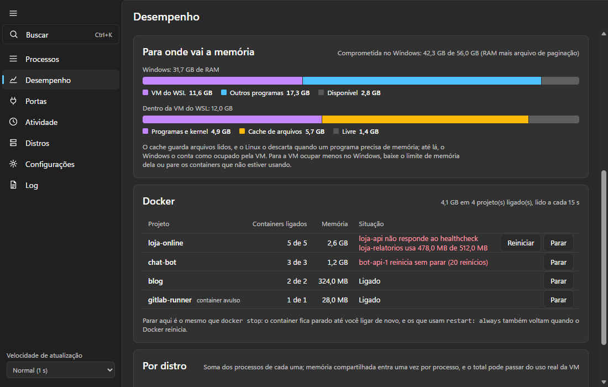
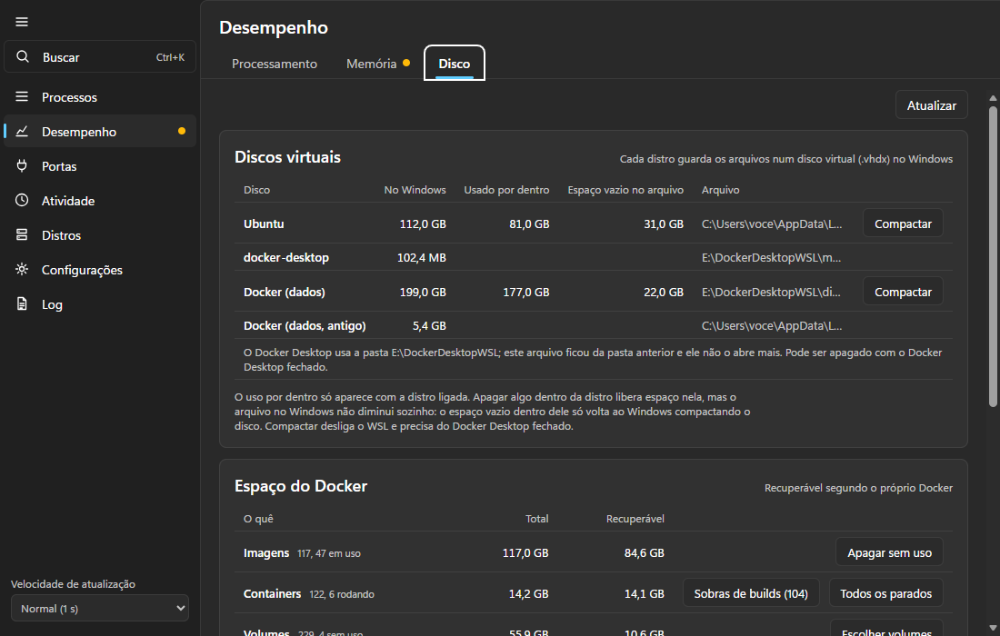

# Toca do Pinguim

Gerenciador de tarefas para o WSL, no formato do Gerenciador de Tarefas do Windows. Mostra o
que roda em cada distro, para onde vai a memória da máquina e o que está preso, sem segurar
nenhuma distro ligada por conta própria.

**[Baixar a versão mais recente](https://github.com/SaLuanVitor/toca-do-pinguim/releases/latest)**:
instalador ou versão portátil, para Windows 10 e 11 com WSL 2. Ou pelo PowerShell:

```powershell
irm https://raw.githubusercontent.com/SaLuanVitor/toca-do-pinguim/main/scripts/instalar.ps1 | iex
```

O instalador ainda não tem assinatura digital, e o SmartScreen avisa na primeira execução;
os detalhes estão em [Instalar](#instalar).

> **In English:** a Task Manager-style app for WSL on Windows 10 and 11. It shows processes,
> CPU, memory and listening ports of every distro, where the Windows RAM goes (WSL cache,
> Docker Compose projects), where the disk space goes, and which containers and processes look
> stuck. It starts, stops and restarts distros, edits every documented `.wslconfig` and
> per-distro `/etc/wsl.conf` setting, and logs WSL failures. It never keeps a distro running
> on its own. The interface is in Brazilian Portuguese.



| Desempenho: Memória | Desempenho: Disco |
|---|---|
|  |  |

As capturas são do modo demonstração, com dados simulados.

## O que ele resolve

- **A memória que some no WSL.** A VM do WSL segura memória no Windows até o teto do
  `.wslconfig`, e boa parte é cache que o Linux só descarta quando falta memória dentro da VM.
  O app mostra quanto é programa, quanto é cache e qual projeto do Docker Compose ocupa mais,
  para ou liga um projeto inteiro com um clique e devolve o cache ao Windows, a pedido ou
  sozinho. Abaixo de 10% de memória livre no Windows, avisa por notificação e diz se quem ocupa
  é o WSL ou os programas do Windows. Em Desempenho > Memória você define o teto de RAM da VM e
  quando o cache volta sozinho; em Desempenho > Processamento, quantos processadores ela pode
  usar.
- **O disco virtual que só cresce.** Desempenho > Disco acha sozinho os discos de toda distro
  instalada, a swap e o disco do Docker, e mostra quanto cada um ocupa no Windows, quais pastas
  de uma distro pesam mais e, com Docker, quanto cada projeto ocupa e o que dá para liberar,
  com limpeza a pedido ou semanal. Compactar o disco devolve ao Windows o espaço que o Linux já
  liberou por dentro.
- **O que está preso.** Container que falha no próprio healthcheck ou reinicia sem parar,
  processo esperando disco ou rede, zumbi que ninguém recolhe. Cada um aparece com o motivo,
  e o container tem botão para reiniciar.
- **O WSL que trava.** Quando o `wsl.exe` para de abrir sessões (`Wsl/Service/0x8007274c`), o app
  avisa e oferece desligar o WSL, em vez de você descobrir pelo terminal parado. O que já está
  rodando, como containers, continua; por isso a trava passa despercebida.
- **Em segundo plano.** Fechar a janela deixa o app na área de notificação, avisando de memória
  acabando e de WSL travado; ele também pode abrir com o Windows, direto lá.
- **Sem segurar distro ligada.** O app lê as distros por dentro, mas o agente dele sai quando a
  sessão dele é a única. Medido: com o app aberto, o agente saiu 2 s depois que uma Debian ficou
  sem sessão, e o WSL a desligou 16 s depois disso.

Usa WSL no dia a dia? Teste e conte numa [issue](https://github.com/SaLuanVitor/toca-do-pinguim/issues)
o que faltou ou o que deu errado. PRs são bem-vindos; o caminho está no
[CONTRIBUTING](CONTRIBUTING.md).

## Abas

| Aba | O que tem |
|---|---|
| Processos | processos de cada distro com CPU e memória; os presos e os zumbis marcados com o motivo; encerramento por SIGTERM ou SIGKILL |
| Desempenho | três abas. **Processamento:** gráfico de CPU da VM, limite de processadores, CPU por distro. **Memória:** gráfico de RAM da VM, para onde vai a RAM do Windows, teto de memória da VM e gatilhos da devolução automática do cache de arquivos, RAM dos projetos do Docker (com parar, ligar e reiniciar o que está com problema) e RAM por distro. **Disco:** discos virtuais com o tamanho no Windows e o ocupado dentro, compactação, pastas maiores de qualquer distro instalada, espaço do Docker por categoria e por projeto do Compose, e limpeza semanal opcional |
| Portas | sockets em escuta na VM, o processo e a distro de cada um |
| Atividade | distros que ligaram e desligaram, quedas do WSL, processos encerrados, falta de memória, containers em ciclo de reinício, configuração |
| Distros | iniciar, terminar, reiniciar, excluir (parada, com cópia opcional) e desligar o WSL |
| Configurações | as 42 chaves do `.wslconfig` e as 19 do `/etc/wsl.conf` de cada distro, em grupos, com o padrão de cada uma e validação |
| Log | o log técnico, por padrão só avisos e erros |

Ctrl+K abre uma busca única por processo, porta, distro ou ação.

## Instalar

Cada versão em [Releases](https://github.com/SaLuanVitor/toca-do-pinguim/releases) traz o
instalador (`_x64-setup.exe`), uma versão portátil (`_x64-portable.zip`) e o
`SHA256SUMS.txt` para conferir o download. Requer Windows 10 ou 11 x64 com WSL 2. Ainda
não há assinatura digital, então o SmartScreen avisa na primeira execução: "Mais
informações" e depois "Executar assim mesmo". O que mudou em cada versão está no
[CHANGELOG](CHANGELOG.md).

Instalado pelo instalador, o app avisa quando sai versão nova e se atualiza com um clique.
Ele procura ao abrir, a cada hora e quando você volta para a janela, e não baixa nada sem você
pedir. O instalador baixado é conferido contra uma assinatura própria do projeto antes de
rodar.

A instalação é só para o seu usuário e não pede administrador. Pelo PowerShell:

| Para | Comando |
|---|---|
| Instalar a versão mais recente (confere o SHA256 antes) | `irm https://raw.githubusercontent.com/SaLuanVitor/toca-do-pinguim/main/scripts/instalar.ps1 \| iex` |
| Abrir | `start toca-do-pinguim`, ou `toca-do-pinguim` no Win+R |
| Remover (mantém histórico e log) | `irm https://raw.githubusercontent.com/SaLuanVitor/toca-do-pinguim/main/scripts/desinstalar.ps1 \| iex` |
| Remover e apagar os dados | `& ([scriptblock]::Create((irm https://raw.githubusercontent.com/SaLuanVitor/toca-do-pinguim/main/scripts/desinstalar.ps1))) -ApagarDados` |
| Instalar ou remover sem perguntas, com o arquivo já baixado | `toca-do-pinguim_X.Y.Z_x64-setup.exe /S` e `"%LOCALAPPDATA%\Toca do Pinguim\uninstall.exe" /S` |

Também dá para remover por Configurações > Aplicativos > Aplicativos instalados. A versão
portátil não instala nada: é abrir o `toca-do-pinguim.exe`. Se o app já estiver aberto, abri-lo
de novo só traz a janela para frente.

## Como funciona

O Windows enxerga todas as distros como um processo só (`vmmemWSL`). Os processos só
podem ser lidos por dentro, então o app copia um agente para cada distro em execução e
conversa com ele por stdin e stdout, uma linha JSON por mensagem.

| Parte | Onde | O que faz |
|---|---|---|
| `crates/protocolo` | as duas pontas | tipos das mensagens; o mesmo crate compila para Windows e Linux |
| `crates/agente` | dentro da distro | binário estático (musl) que lê `/proc` e aplica sinais; recusa o PID 1 |
| `src-tauri` | Windows | lista distros, supervisiona os agentes, guarda histórico e atividade, edita o `.wslconfig` |
| `src` | WebView2 | SvelteKit em modo SPA |

O agente vai para `/var/lib/toca-do-pinguim/agente-<hash>` dentro de cada distro, numa pasta
que só o root lê e grava, copiado pelo stdin do `wsl.exe`. Ele sai quando o stdin fecha, então fechar o app encerra todos os agentes.
Além dos processos, ele lê as portas em escuta a cada 5 amostras e as mortes por falta de
memória no `/dev/kmsg`.

**Ociosidade.** O WSL desliga uma distro quando não sobra sessão aberta nela (cada
`wsl.exe` conectado aparece lá dentro como um `SessionLeader`). Medido no WSL 2.6.1 numa
Debian com systemd: com `cron`, `dbus` e `journald` rodando, ela desligou 16 s depois que
a última sessão fechou. O agente roda numa sessão, então sai sozinho quando a dele é a
única, e o app espera o `instanceIdleTimeout` (padrão 15 s, lido do `.wslconfig`) mais 5 s
antes de subir outro. Se a distro continua ligada depois disso, algo além do app a segura.
Toda chamada ao `wsl.exe` tem prazo, porque uma sessão presa também segura a distro.

Não foi medido se um processo solto da sessão (`setsid`) segura uma distro sem systemd: o
único teste disso coincidiu com o serviço do WSL parando de responder.

Com a janela minimizada, as amostras param de ir ao front e os agentes passam a ler a
cada 5 s.

**Memória do Windows e Docker.** A cada 5 s o app lê a memória do Windows e quanto o processo
`vmmemWSL` ocupa nele, sem precisar de administrador. Abaixo de 10% de memória disponível ele
avisa na tela e por notificação do Windows, e o aviso some acima de 15%. Com a distro
`docker-desktop` ligada, a CLI `docker` do Windows é lida a cada 15 s (`ps`, `inspect` e
`stats`; medido, de 4 a 5 s juntos com 19 containers), e com a janela minimizada só quando
o aviso de memória está aceso. Parar um projeto é um `docker stop` dos containers dele: nada
é apagado.

**Devolver o cache.** O botão roda `sync` e `echo 3 > /proc/sys/vm/drop_caches` numa distro
já ligada, como root, e mede a memória do `vmmemWSL` 15 s e 2 min depois. A opção automática,
em Desempenho > Memória, faz o mesmo quando a memória livre do Windows fica abaixo da
porcentagem escolhida (10% por padrão) ou quando o cache da VM passa do tamanho escolhido, no
máximo uma vez a cada 10 minutos, e vem desligada; ela fica em `preferencias.json`, na pasta
de dados do app. O limite de processadores, em Desempenho > Processamento, grava a linha `processors` do `.wslconfig` e
vale quando o WSL reinicia. Medido numa máquina
com um job de CI e 15 containers: 2,9 GB voltaram em 30 s, e 1,3 GB ainda estavam livres
5 min depois. O que volta rápido é o cache de nomes e pastas e o de blocos lidos, enquanto
algo continua percorrendo arquivos. Baixar o limite da VM é o que segura o cache de vez.

**Disco.** As distros vêm do registro do WSL (`HKCU\Software\Microsoft\Windows\CurrentVersion\Lxss`),
então aparece toda distro instalada, em qualquer pasta, inclusive as que Rancher Desktop e Podman
registram. O tamanho de cada `.vhdx` vem do arquivo no Windows, e o ocupado vem do `df` dentro
da distro, então só aparece com ela ligada. A swap vem do `swapFile` do `.wslconfig` ou, sem
ele, do `%Temp%`. O Docker é lido por `docker system df`;
as limpezas são `container prune` (por padrão só os sem rótulo de projeto do Compose),
`image prune -a`, `builder prune -a` e `volume rm` dos volumes que você marcar. Por projeto, o
app soma containers, volumes e a parte única das imagens que só aquele projeto usa, e apaga
os containers parados dele (`container prune` com o rótulo do projeto) ou os volumes que
nenhum container usa. A análise de
pastas roda um `du` só, como root, na distro escolhida; distro desligada só é ligada com
confirmação, e o WSL a desliga sozinho quando ela fica ociosa; medido num Ubuntu com 81 GB usados, o
`du` levou 172 s com o cache de disco quente, e o app desiste em 20 min, com o `du` encerrado
junto;
só o que ela listou como removível pode ser apagado, e entrada do `/tmp` montada por um
container ligado fica bloqueada. A última análise de cada distro fica em `analises.json`, na
pasta de dados do app, e volta ao abrir a aba; apagar exige uma análise de menos de 30 min.
A última leitura dos discos e do Docker fica em `leituras.json`, na mesma pasta: a aba abre com
ela e lê de novo por trás quando ela tem mais de 1 min.

**Compactar o disco.** O `.vhdx` cresce e não encolhe sozinho. O botão Compactar roda
`fstrim` na distro, se ela estiver ligada, desliga o WSL e roda o `diskpart` (`attach vdisk
readonly`, `compact vdisk`, `detach vdisk`) como administrador, então o Windows pede a
permissão. É o caminho que existe no Windows 11 Home, que não tem `Optimize-VHD`. O Docker
Desktop precisa estar fechado, porque ele religa o WSL logo depois do desligamento e prende o
disco. Disco esparso não aparece com o botão, porque o Windows já o encolhe sozinho. Nada dentro
do disco é apagado, e o WSL fica desligado no fim. Terminar só a distro não basta: medido no
WSL 2.6.1, com a distro parada o disco dela continua preso à VM por mais de 3 min, e só o
`--shutdown` o solta.

**Excluir distro.** Só com a distro parada, conferida de novo logo antes de excluir. A cópia
opcional é um `wsl --export` para um `.tar` novo, numa pasta que existe e fora da pasta da
distro; medido, exportar uma distro parada não a liga. Depois vem o `wsl --unregister`, que,
medido numa distro importada, apaga a pasta dela inteira, com o disco. As distros do Docker Desktop não têm o botão: elas se removem pelo próprio Docker.

**Processos e containers presos.** O Linux não marca processo como travado; o app aponta
sinais. Na aba Processos: estado `D` por mais de 1 min (esperando disco ou rede, e encerrar só
funciona quando a espera termina), zumbi por mais de 1 min e um núcleo inteiro por mais de
5 min, que pode ser só trabalho pesado, como uma compilação. No Docker: healthcheck falhando e
memória acima de 90% do limite do container. Notificação do Windows só para os sinais firmes:
healthcheck falhando e reinício em ciclo.

**Dados.** Em `%APPDATA%\com.luan.tocadopinguim`: `memoria.csv` (pico de memória usada por
minuto, 30 dias) e `atividade.jsonl` (últimos 1000 eventos). Na primeira abertura, os dois
são copiados de `%APPDATA%\com.luan.wsltm`, a pasta de quando o app se chamava Gerenciador
de WSL; a pasta antiga fica como está. A sugestão de limite é o pico
dos últimos 7 dias com 25% de folga, arredondado para cima em GB, e só aparece depois de
uma hora de dados. Gravar o limite troca só a linha `memory` do `.wslconfig` e guarda a
versão anterior em `.wslconfig.toca-do-pinguim.bak`.

## Desenvolvimento

Requisitos: Rust com o alvo `x86_64-unknown-linux-musl` e Node.

```bash
rustup target add x86_64-unknown-linux-musl
npm install
npm run tauri dev
```

O agente é compilado no Windows com o `rust-lld` (ver `.cargo/config.toml`), sem
toolchain dentro da distro. `npm run tauri dev` e `npm run tauri build` compilam o agente
antes do app, porque o binário dele é embutido no executável.

Aberto num navegador comum (`npm run dev`), o front roda em modo demonstração, com
dados simulados e um aviso na tela.

## Branches

| Branch | Recebe | Por |
|---|---|---|
| `main` | só versões prontas; é dela que saem as tags `vX.Y.Z` | PR de `develop` |
| `develop` | o trabalho do dia a dia | PR de `feat/...`, `fix/...`, `ci/...` e `release/...` |

As duas são protegidas: nada entra sem PR, os workflows Verificar e Segurança precisam
passar, e não se apaga nem se reescreve a história delas. As tags `v*` também não podem ser
apagadas nem movidas.

## Publicar uma versão

A versão mora no `package.json`. O `tauri.conf.json` lê de lá, e o
`scripts/sincronizar-versao.mjs` copia o número para o `Cargo.toml` e o `Cargo.lock`.

1. Numa branch `release/X.Y.Z` saída de `develop`, mova o que está em "Não lançado" no
   `CHANGELOG.md` para uma seção da versão e faça o commit.
2. Rode `npm version X.Y.Z --no-git-tag-version` e faça o commit `chore: versão X.Y.Z`. O
   comando sincroniza a versão nos arquivos do Rust.
3. Abra o PR para `develop` e, depois de mesclado, o PR de `develop` para `main`.
4. Na `main` atualizada, crie e envie a tag: `git tag -a vX.Y.Z -m "Toca do Pinguim X.Y.Z"` e
   envie só ela ao remoto.
5. O workflow Publicar confere que a tag está na `main` e bate com a versão, gera os pacotes,
   assina o instalador e abre uma release em rascunho com as notas do CHANGELOG.
6. Antes de publicar, baixe o instalador do rascunho e passe no Windows Defender:
   `gh release download vX.Y.Z -p "*setup.exe"` e
   `& "$env:ProgramFiles\Windows Defender\MpCmdRun.exe" -Scan -ScanType 3 -File <instalador> -DisableRemediation`.
   Os instaladores publicados da 0.7.0 e da 0.8.0 foram acusados como
   `Trojan:Win32/Bearfoos.A!ml`, sem assinatura digital, enquanto o mesmo código montado de
   novo passava limpo. Só publique pela página de Releases se a verificação disser
   `found no threats`.

Rodar o Publicar à mão, pela aba Actions, gera os pacotes sem assinatura, como artefato, sem
release.

A atualização automática só enxerga a release depois de publicada, porque lê o
`latest.json` de `releases/latest`. A chave privada que assina o instalador fica no secret
`TAURI_SIGNING_PRIVATE_KEY` do ambiente `publicacao`, que só aceita tags `v*`, e só o job
`assinar` a recebe: ele baixa o instalador já montado e roda o assinador do Tauri numa
versão fixa, sem passar pelo build. A chave pública correspondente está em
`tauri.conf.json`. **Perder a chave privada impede atualizar quem já instalou:** uma chave
nova exige que todos reinstalem à mão.

## Medido em 2026-10-28

Windows 11, WSL 2.6.1, duas distros rodando (Ubuntu com 16 processos, docker-desktop
com 162), executável de release:

| Medida | Valor |
|---|---|
| Executável | 3,8 MB |
| Agente | cerca de 0,5 MB de memória, 1 a 20 ms por leitura conforme o número de processos |
| CPU da árvore do app, janela visível, 1 leitura/s | 3,2% a 3,9% de um núcleo |
| CPU da árvore do app, janela minimizada | 0,2% de um núcleo |
| Memória privada da árvore do app | 226 a 273 MB, quase toda do WebView2 |
| App aberto, Debian ligada sem sessão | agente saiu 2 s depois; o WSL a desligou 16 s depois disso |
| App aberto, Debian com uma sessão de 40 s | agente ficou durante a sessão e saiu quando ela fechou; desligou 16 s depois |

Medições únicas, numa máquina; não são dado de campo.

## Privacidade

O único acesso do app à internet é a busca de versão nova, ao abrir, a cada hora e ao voltar
para a janela: ele consulta as versões publicadas em github.com, e o GitHub recebe o endereço
IP do computador, como em qualquer visita a um site. A busca se desliga em Configurações > Este app. Nada mais
sai da máquina: o log, o histórico de memória e a atividade ficam só nela. O instalador mostra
este aviso antes de instalar.

## Política de assinatura (code signing policy)

Os instaladores ainda não têm assinatura digital do Windows. O projeto vai pedir assinatura
gratuita à [SignPath Foundation](https://signpath.org), que assina apenas o que a CI do GitHub
compila a partir deste repositório, e cada versão só é assinada depois de aprovada à mão.

| Papel | Quem |
|---|---|
| Autores e revisores (*committers and reviewers*) | [SaLuanVitor](https://github.com/SaLuanVitor) |
| Aprovadores (*approvers*) | [SaLuanVitor](https://github.com/SaLuanVitor) |

Toda mudança entra por PR nas branches protegidas, e quem não é autor tem o PR revisado antes
de entrar.

## Contribuir

Veja o [CONTRIBUTING.md](CONTRIBUTING.md). Falha de segurança se relata em particular, como
descrito no [SECURITY.md](SECURITY.md). O projeto segue um [código de conduta](CODE_OF_CONDUCT.md).

## Licença

[MIT](LICENSE). As licenças das bibliotecas de terceiros incluídas no app vão no
`THIRD-PARTY-NOTICES.md` de cada versão em Releases e dentro do zip portátil.
